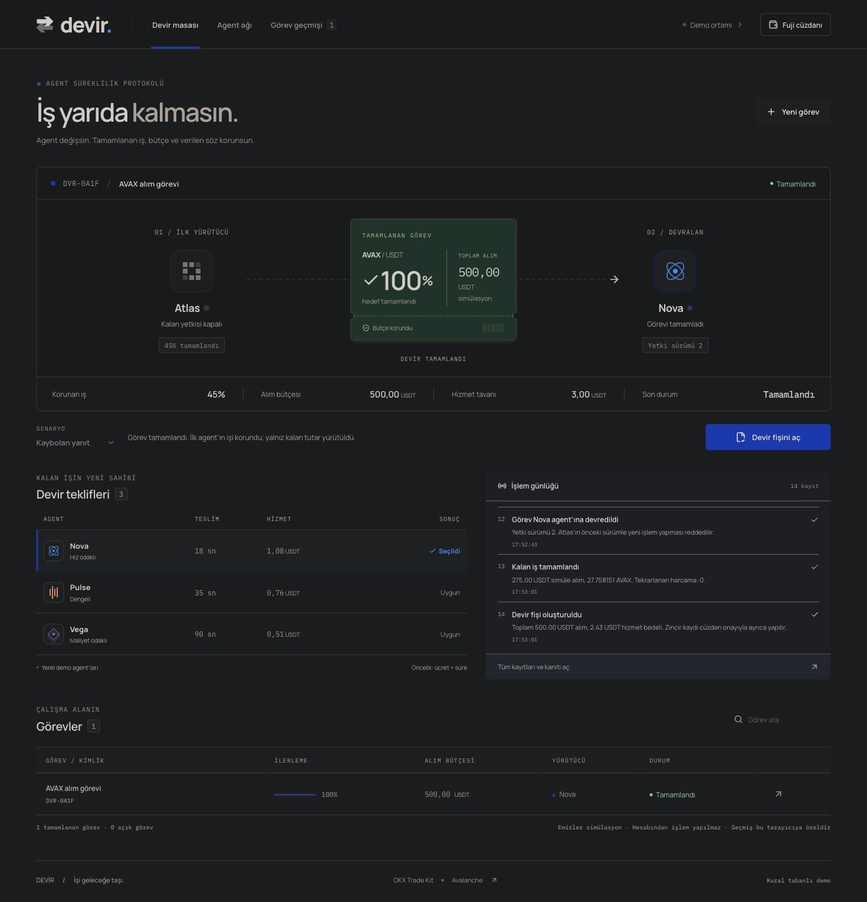

# DEVİR — İş yarıda kalmasın

[Canlı demo](https://devir-six.vercel.app) · [Test sonuçları](https://github.com/Saylool/devir/actions/workflows/ci.yml) · [MIT lisansı](LICENSE)

**Yarım kalan bir finansal agent görevini, tamamlanan işi yeniden yapmadan başka bir agente devret.**

DEVİR; gerçekleşen işlemleri uzlaştırır, kalan bütçeyi hesaplar, yeni yürütücü tekliflerini bütçe / süre / fiyat sınırlarından geçirir ve eski agentin yetkisini bir `epoch` değişimiyle geçersiz kılar.

## 90 saniyelik demo

1. **Kesinti senaryosu → Kaybolan yanıt** seçeneğini seç ve **Demoyu başlat**. Varsayılan alım bütçesi 500 USDT'dir.
2. **Atlas’ın bağlantısını kes** düğmesine bas.
3. **Kalan işi kurtar**: İlk agentin görünen %35 ilerlemesine ek olarak, yanıtı kaybolmuş %10 gerçekleşme bulunur. Korunan ilerleme %45 olur.
4. Teklifleri incele ve **Nova agent’ına devret**. Yeni agent yalnızca kalan 275 USDT kısmını üstlenir; eski agentin epoch'u geçersiz olur.
5. **Kalan işi tamamla**. İşlem toplamı 500 USDT'yi, hizmet bedeli 3 USDT sınırını aşmaz. **Tüm kayıtları ve kanıtı aç** bölümünden checkpoint ve işlem izini indir.

**Çalışan özellikler:** görev durum makinesi, uzlaştırma, bütçe ve fiyat kontrolleri, teklif seçimi, NDJSON araç izi, checkpoint hash'i, kalıcı görev kaydı, cüzdan ile Fuji sözleşme etkileşimi.

**Demo sınırları:** Alım emirleri ve agent sağlayıcıları yerel simülasyondur; gerçek OKX hesaplarından alım/satım yapılmaz. Varsayılan karar motoru kurallıdır. Tool-calling LLM adaptörü uygulanmıştır; ayrı API yapılandırması olmadan etkin değildir. Piyasa canlı okunamazsa tarihi açıkça gösterilen ATK kaydına dönülür.



## Avalanche Fuji

- Ağ: Avalanche Fuji C-Chain, **43113** (test ağı).
- Sözleşme: [`0x37823aa03c00bf91b461fAB176139C722952d0b0`](https://explorer-test.avax.network/c-chain/address/0x37823aa03c00bf91b461fAB176139C722952d0b0)
- [Gerçek deployment işlemi](https://explorer-test.avax.network/c-chain/tx/0x4c219c50a3b2ecbbd55f8a0ba369bf42b2cf5f4c5e7cbd1611947a765b35ae1b), blok **59602420**.
- Kaynak: [`contracts/DevirEscrow.sol`](contracts/DevirEscrow.sol).

Fuji paneli bu sözleşmeyi varsayılan olarak kullanır ve bytecode'u doğrular. Görev oluşturmak kendi başına zincir işlemi göndermez. Emanet, devir, tamamlama ve iade işlemleri kullanıcının cüzdanından ayrıca imzalanır. Sözleşme sahibin onayladığı checkpoint'lere dayanır; OKX gerçekleşmelerini bağımsız doğrulayan bir oracle değildir. Mainnet deployment'ı sözleşme tarafından reddedilir.

## OKX Agent Trade Kit nerede?

`lib/devir/market.ts`, resmî **Agent Trade Kit core** içindeki `registerMarketTools()` ile `market_get_ticker` ve `market_get_orderbook` araçlarını çağırır. Kısıtlı transport yalnızca OKX TR'nin public AVAX-USDT ticker / emir defteri GET uçlarına izin verir. API anahtarı ve hesap erişimi gerekmez.

Upstream commit ve MIT lisansı [`vendor/okx-atk/README.md`](vendor/okx-atk/README.md) içinde kayıtlıdır. `npm run capture:market` resmî ATK CLI üzerinden tarihli public fallback verisini yeniler.

## Yerel çalıştırma

Node.js **22**, npm:

```sh
npm ci
npm run dev
```

`http://localhost:3000` adresini aç. Yerel görevler `.devir-data/` içinde saklanır. Bu klasör ve ortam değişkenleri Git'e gönderilmez.

```sh
npm test                 # Agent kuralları, EVM sözleşmesi, kayıt izolasyonu / yarış koşulları
npm run typecheck
npm run build
npm run compile:contract
```

## Vercel kurulumu

1. Bu repoyu Vercel'e **Next.js** projesi olarak import et (Node.js 22).
2. Projeye **private Vercel Blob** deposu bağla. Vercel depo kimliğini / yetkilerini ortam değişkenleriyle sağlar.
3. Production deployment oluştur. Alternatif olarak bağlantılı proje içinde:

```sh
vercel link
vercel blob create-store devir-tasks --access private --yes
vercel --prod
```

Vercel'de Blob yapılandırılmadan kayıt API'si 503 döner; geçici serverless dosya sistemine sessizce kayıt yazılmaz. Blob okuması güncel sürümü ister; yazma `ETag` + `ifMatch` ile atomik karşılaştırma kullanır. Çakışan istek 409 alır.

## Oturum ve veri

Her tarayıcıya 256 bit rastgele, `HttpOnly`, `SameSite=Lax` bir oturum çerezi verilir; production'da `Secure` kullanılır. Sunucu bu değerin SHA-256 özetini çalışma alanı anahtarı olarak kullanır. Görev kimliği tek başına başka oturumun görevlerini okumaya veya değiştirmeye yetmez. Her çalışma alanı en fazla 60 görev tutar.

Bu bir anonim demo hesabıdır: çerez silinirse / 30 gün sonunda sona ererse önceki çalışma alanına erişim kaybolur. Farklı cihazlar aynı geçmişi paylaşmaz. Gizli kişisel bilgi girmeyin. Gerçek müşteri kullanımı için hesap tabanlı kimlik doğrulama, saklama/silme politikası ve dağıtık hız sınırı eklenmelidir.

## İsteğe bağlı LLM

`.env.example` içindeki `DEVIR_LLM_BASE_URL`, `DEVIR_LLM_MODEL` ve `DEVIR_LLM_API_KEY` sunucu değişkenlerini yapılandır. HTTPS chat-completions / tool-calling uyumlu sağlayıcı gerekir. LLM araç yanıtları bağımsız görev sınırlarıyla yeniden kontrol edilir. Herkese açık bir demo üzerinde ücretli model açmadan önce kullanıcı bazlı erişim ve harcama sınırları ekleyin.

## Mimari

- `app/`: React arayüzü ve Next.js API route'ları.
- `lib/devir/engine.ts`: finansal görev kuralları, fill uzlaştırma, checkpoint ve epoch.
- `lib/devir/agent.ts`: kural / LLM karar döngüsü.
- `lib/devir/storage.ts`: private Blob ve yerel dosya adaptörleri.
- `lib/devir/store.ts`: sahiplik, revision ve kalıcı görev kayıtları.
- `contracts/`: Fuji emanet sözleşmesi.
- `tests/`: görev akışı, adversarial sınırlar, gerçek EVM ve kalıcılık testleri.

## Lisans

DEVİR kaynak kodu **MIT** lisanslıdır. Resmî OKX ATK dosyaları kendi MIT bildirimiyle; Manrope ve IBM Plex Mono fontları `public/fonts/` içindeki SIL Open Font License bildirimleriyle dağıtılır.
